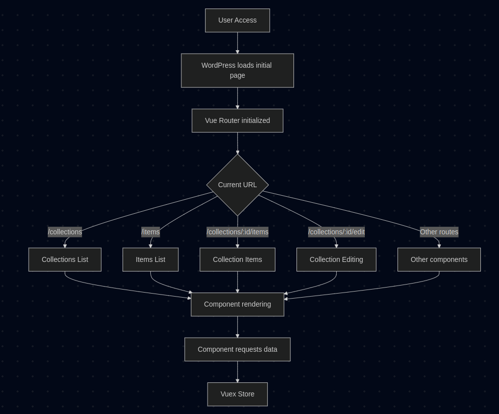

# Technical Architecture

This document consolidates the technical architecture of Tainacan, detailing its structure as a WordPress plugin.

The topics cover everything from the internal workings of the plugin (entities, repositories, controllers, and business logic), through the public REST API and its features, to the modeling and manipulation of data in the relational database. Solutions for data import/export and asynchronous process are also described.


## 1. Backend of the Tainacan Plugin

Tainacan is developed as a WordPress plugin, leveraging its native structure and extending it with custom entities for digital collections. The backend is divided into layers:

* **Entities**: Representations of business objects (collections, items, metadata, etc.).
* **Repositories**: Responsible for abstracting access to the database.
* **Controllers**: Handle requests received via the REST API.

There are other parts of the code that leverage functionality related to consuming and manipulating data but these three are the most relevant.

### 1.1 Where the code lives

From Tainacan source code, the content on `src/` holds the portion of the code that WordPress loads. Everything outside it is the development workspace (`tests`, `wp-repo-assets`, etc).

| Path | What it holds |
| --- | --- |
| `src/tainacan.php` | Plugin header, constants, and the first `require` |
| `src/classes/tainacan-creator.php` | Autoloader and the handlers started at boot |
| `src/classes/entities/` | Entity classes |
| `src/classes/repositories/` | Persistence |
| `src/classes/api/` | REST controllers |
| `src/classes/background-process/` | Importers, exporters, and other background jobs |
| `src/classes/mappers/` | Metadata standards, such as Dublin Core |
| `src/classes/exposers/` | Alternative API response formats |
| `src/classes/oaipmh/` | OAI-PMH protocol support |
| `src/classes/theme-helper/` | Template tags for themes |
| `src/views/admin/` | Admin application |
| `src/views/gutenberg-blocks/` | Block editor blocks |
| `src/migrations.php` | Upgrades for existing installs |

Where each record is stored is in [Key concepts](key-concepts.md). How to create and read one is the [internal API](internal-api.md). The class reference generated from the source is the [code reference](phpdoc/Home.md).

### 1.2 How the plugin starts

`src/tainacan.php` defines the constants and loads `src/classes/tainacan-creator.php`, then `src/migrations.php`. The creator file loads the background-process handlers and calls `get_instance()` on `Importer_Handler`, `Exporter_Handler`, and `Generic_Process_Handler`. It then registers `tainacan_autoload()`. A class named `Tainacan\Some_Class` is loaded from a file named `class-tainacan-some-class.php` in one of the directories that file lists.

## 2. REST API

Tainacan's REST API provides a comprehensive set of endpoints for managing the system's entities. It is built upon the WordPress REST standard, extending it with custom controllers for each resource.

### 2.1 API Resources

* CRUD for collections, items, metadata, filters, taxonomies
* Bulk operations and editing of multiple items
* Import/export sessions
* Faceted search and facet retrieval

### 2.2 Detailed Documentation

The complete REST API specification with all endpoints, parameters, and examples is available at:

📄 [REST API Docs](https://redocly.github.io/redoc/?url=https://raw.githubusercontent.com/tainacan/tainacan/refs/heads/develop/docs/openapi.json#tag/items)

### 2.3 Specific REST Controllers

The Tainacan REST API is structured through specialized PHP controllers, each responsible for a resource. They extend a base class called `REST_Controller` and define their own endpoints. Examples:

* `REST_Collections_Controller`: Manages collections (`/collections`)
* `REST_Items_Controller`: Manages items (`/items`)
* `REST_Exposers_Controller`: Manages exposers formats (`/exposers`)
* `REST_Background_Processes_Controller`: Monitors asynchronous processes (`/bg-processes`)
* `REST_BulkEdit_Controller`: Handles bulk editing of items (`/collection/{id}/bulk-edit`)

### 2.4 Authentication

Authentication in Tainacan's REST API follows WordPress standards. In authenticated environments (such as the admin panel), session cookies are used. For external applications, it's recommended to use WordPress [REST API authentication methods](https://developer.wordpress.org/rest-api/using-the-rest-api/authentication/#basic-authentication-with-application-passwords).

### 2.5 API Usage Example

List items from collection with ID 1:

```bash
curl -X GET "https://yourdomain.com/wp-json/tainacan/v2/collection/1/items"
```

## 3. Frontend ⇄ Backend ⇄ Database Integration

Tainacan Admin panel is mostly coded as a Single Page Application, where all the data fetching and manipulation is done via REST API. Similar fetching cycles also occur inside Gutenberg Blocks, such as the Faceted Search and the Item Submission Form.

### 3.1 Request Cycle

1. The frontend (Vue.js SPA) sends HTTP requests via `Axios`.
2. REST controllers receive and validate the data.
3. Data is converted into domain entities.
4. Repositories handle persistence.
5. The formatted JSON response is returned to the frontend.


## 4. Data Architecture

Tainacan's data architecture is based on WordPress infrastructure, using and extending its relational model. The system incorporates Custom Post Types, Custom Taxonomies, Custom Post Meta, and additional tables for asynchronous operations.

### 4.1 Storage Structure

| Component                    | WordPress Table(s)             | Technical Notes                |
| ---------------------------- | ------------------------------ | ------------------------------ |
| Collections, Items, Metadata | `wp_posts`                     | Identified by `post_type`      |
| Metadata and Term values        | `wp_postmeta`, `wp_termmeta`   | Key-value pairs for extra data |
| Taxonomies and Terms         | `wp_terms`, `wp_term_taxonomy`,  `wp_term_relationships`  | Used for categorization        |
| Background Processes         | `wp_tnc_bg_process`            | Import, export, bulk edition etc. |

The `post_type` value for each entity is in [Key concepts](key-concepts.md#storage). An item is a post of type `tnc_col_{id}_item`, not a single shared post type.

### 4.2 Domain relationships

How collections, items, metadata, taxonomies, and filters relate is described in [Key concepts](key-concepts.md#relationships).

### 4.3 Data Handling and WordPress Database Access

Data manipulation in the Tainacan plugin is performed using a combination of native WordPress functions and direct database access when needed.

#### WordPress Native Functions

For most standard operations, Tainacan relies on WordPress native functions such as:

- `wp_insert_post()`
- `get_post_meta()`
- `update_post_meta()`
- `wp_insert_term()`
- Among others.

These functions ensure compatibility with the WordPress ecosystem and benefit from built-in features like caching and hooks.

#### Direct Database Access with `$wpdb`

For more complex scenarios or when dealing with custom database tables (e.g., background processes), Tainacan uses direct SQL access via the `$wpdb` object:

- Example tables: `wp_tnc_bg_process`, `wp_tnc_log`
- Example methods: `$wpdb->insert()`, `$wpdb->get_results()`, `$wpdb->query()`

## 5. Import and Export System

Tainacan features a flexible structure for data import and export. Operations are performed through sessions and executed asynchronously.

### 5.1 How records leave the repository

Four mechanisms are easy to mix up:

| Mechanism | What it does |
| --- | --- |
| Mapper | Renames a collection's metadata to a standard, such as Dublin Core. It does not write a file or change the response format. |
| Exposer | Changes the REST response for a request, for example to XML or CSV. A request can ask for a mapper the exposer supports. |
| Exporter | Builds a downloadable file in the background. The file can use the collection's own metadata or a mapped standard. |
| OAI-PMH | An exposer with a fixed mapper. `Tainacan\Exposers\OAI_PMH` accepts only Dublin Core. |

See [Exporting and exposing](exporting-and-exposing.md), [Mapping standards](mapping-standards.md), and [Exposers](exposers.md).

### 5.2 Import

* Available importers: CSV, Flickr, YouTube, etc.
* Sessions created via `/importers/session`
* File upload, metadata mapping, background execution
* Base class: `class-tainacan-importer.php`
* Manager: `class-tainacan-importer-handler.php`

### 5.3 Export

* Exporters: CSV, Vocabulary CSV.
* Customizable sessions
* Base class: `class-tainacan-exporter.php`
* Asynchronous execution with access to logs/results via endpoint
* Manager: `class-tainacan-exporter-handler.php`

### 5.4 Other background work

Bulk edit is not an importer or an exporter. `Generic_Process_Handler` registers it as `Tainacan\GenericProcess\Bulk_Edit_Process` and runs it on the same background-process queue. Plugins can register further processes on the `tainacan-register-generic_process` action.

## 6. Frontend Architecture

The Tainacan frontend is a Vue.js 3 application that provides an interface for managing digital repositories. It is implemented as a Single Page Application (SPA) using Vue.js 3, with routing managed by Vue Router and state management via Vuex. It communicates with the backend through Tainacan's REST API.

As a SPA, Tainacan loads only a single initial HTML page and then dynamically updates the content as the user navigates, without reloading the entire page. This provides a smoother and faster user experience. A key feature of the frontend is the faceted search, which allows users to intuitively explore the collection by combining multiple filters using interactive components that update results in real-time. It is implemented through an interface with **interactive filter panels**, offering control types like checkboxes, text fields, and date selectors, adapted to the data type being filtered.

This document presents the routing and data flow flowchart of Tainacan's Single Page Application (SPA), showing how initialization, routing, and data flow between components occur.




### 6.1 File Locations

The frontend files are primarily located in:

- `/src/views/admin/` – Main administrative interface
- `/src/views/gutenberg-blocks/` – Blocks for the WordPress Gutenberg editor

### 6.2 Main Components

#### 6.2.1 Main Page

The main component of the application is `src/views/admin/admin.vue`. It initializes the Vue app and defines the main layout, including:

- Side navigation menu
- Header
- Main content area
- Route management

#### 6.2.2 Routing System

The routing system is defined in `src/views/admin/js/router.js`. It uses Vue Router to manage navigation between different screens of the application.

Main route groups:

**Repository-level pages**:
   - `/home` – Home page
   - `/collections` – List of collections
   - `/items` – Repository items list
   - `/metadata` – Repository metadata
   - `/filters` – Repository filters
   - `/taxonomies` – Taxonomies
   - `/activities` – Repository activities
   - `/capabilities` – Repository permissions
   - `/importers` – Import tools
   - `/exporters` – Export tools


### 6.3 Organization

The application's pages are organized and located in:

- `/src/views/admin/pages/home-page.vue` – Home page
- `/src/views/admin/pages/lists/` – List pages (collections, items, etc.)
- `/src/views/admin/pages/singles/` – Detail pages (collection, item, etc.)

Reusable components are located in `/src/views/admin/components/`, organized by functionality:

- `/navigation/` – Navigation components (menus, breadcrumbs, etc.)
- `/edition/` – Editing forms
- `/search/` – Search and filtering components
- `/other/` – Miscellaneous components

### 6.4 State Management

Tainacan uses Vuex for centralized state management. The main state modules include:

- **Collection**: State related to the current collection
- **Item**: State related to the current item
- **Search**: State related to search and filtering
- **Filter**: State related to available filters
- **Metadata**: State related to available metadata


