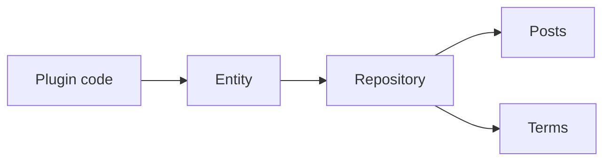

# Tainacan internal API

This page describes the PHP API used inside WordPress to create and read Tainacan entities. The [REST API](https://redocly.github.io/redoc/?url=https://raw.githubusercontent.com/tainacan/tainacan/refs/heads/develop/docs/openapi.json ":ignore") is a separate interface. The names used below (collection, item, metadatum, filter, taxonomy, term) are introduced in [General concepts](/general-concepts) and mapped to code in [Key concepts](key-concepts.md).

Method lists live in the [code reference](phpdoc/Home.md). This page describes the shared routine. Each entity page describes only the calls that differ from it. Longer sequences are in [Examples](#examples).

## Entities and repositories

Every entity has an entity class and a repository class.

The entity is one record. Setters such as `set_name()` change it in memory. `validate()` checks those values. `get_errors()` returns the messages when validation fails.

The repository reads and writes the database. It is a singleton. These functions return the instances:

- `tainacan_collections()`
- `tainacan_metadata()`
- `tainacan_metadata_sections()`
- `tainacan_items()`
- `tainacan_item_metadata()`
- `tainacan_filters()`
- `tainacan_taxonomies()`
- `tainacan_terms()`
- `tainacan_logs()`



Most entities are WordPress posts:

| Entity | Post type |
| --- | --- |
| Collection | `tainacan-collection` |
| Metadatum | `tainacan-metadatum` |
| Metadata section | `tainacan-metasection` |
| Filter | `tainacan-filter` |
| Taxonomy | `tainacan-taxonomy` |

An item is a post whose type is the collection identifier `tnc_col_{id}_item`. A term is a WordPress term in the taxonomy `tnc_tax_{id}`. An item metadata value is a post meta row, a term relationship, or a core item property, depending on the metadatum type. The repository map records which property is a post field and which is meta. That map is `_get_map()` on the repository class, linked from each entity page.

## Saving

Create an entity, set the properties the record needs, validate, then insert. `insert()` returns a new instance of the saved entity. Read the ID from that instance.

`set_status('publish')` stores a public record. `publish`, `private`, `pending`, and `future` require a successful `validate()` before `insert()`. Otherwise `insert()` throws `Entities must be validated before you can save them`. Any setter clears the previous validation, so call `validate()` again after a change.

```php
$collection = new \Tainacan\Entities\Collection();
$collection->set_name( 'Paintings' );
$collection->set_status( 'publish' );

// validate() checks the values in memory. insert() writes them.
if ( $collection->validate() ) {
	$collection = tainacan_collections()->insert( $collection );
	$collection_id = $collection->get_id();
} else {
	$errors = $collection->get_errors();
}
```

To change a saved entity, set the new values on that instance and call `validate()` and `insert()` again. `insert()` updates the post when the entity already has an ID. Repository `update()` methods call `insert()` after their own preparation.

```php
$collection->set_description( 'Public paintings.' );

if ( $collection->validate() ) {
	$collection = tainacan_collections()->insert( $collection );
}
```

`trash( $entity )` moves the post to the trash. `delete( $entity )` removes it. Terms are removed permanently; see [Terms](repository-terms.md).

> [!WARNING]
> `insert()`, `trash()`, and `delete()` save for the current request without consulting capabilities. Call `can_edit()` or `can_delete()` first. See [Permissions](#permissions).

## Reading

`fetch( $id )` returns the entity, or an empty array when the post is missing, has another post type, or the current user cannot read it.

```php
$collection = tainacan_collections()->fetch( 23 );
```

`new \Tainacan\Entities\Collection( 23 )` loads the same post. It throws when the ID is missing or the post type does not match.

`fetch( $args )` accepts [`WP_Query` arguments](https://developer.wordpress.org/reference/classes/wp_query/ ":ignore") and returns a `WP_Query` by default. The same call with `'OBJECT'` returns an array of entities. `fetch_one( $args )` returns the first entity, or `false`.

A query may use the WordPress argument or the mapped property name. Both calls below look for a metadatum whose `required` value is `yes`.

<!-- tabs:start -->

#### **Mapped property**

```php
$metadata = tainacan_metadata()->fetch(
	array(
		'required' => 'yes',
	),
	'OBJECT'
);
```

#### **meta_query**

```php
$metadata = tainacan_metadata()->fetch(
	array(
		'meta_query' => array(
			array(
				'key'   => 'required',
				'value' => 'yes',
			),
		),
	),
	'OBJECT'
);
```

<!-- tabs:end -->

`name` in a collection query is the same kind of shortcut for the post title. [Items](repository-items.md) take the collection as a second argument. [Terms](repository-terms.md) use `get_terms()` arguments instead of `WP_Query`.

## Permissions

Each entity implements `can_read()`, `can_edit()`, and `can_delete()`. They check the current user, or the user passed as an argument.

```php
$collection = tainacan_collections()->fetch( 23 );

if ( $collection instanceof \Tainacan\Entities\Collection && $collection->can_edit() ) {
	$collection->set_description( 'Updated description.' );

	if ( $collection->validate() ) {
		$collection = tainacan_collections()->insert( $collection );
	}
}
```

Capability names and role maps are documented in [Roles and capabilities](roles-capabilities.md).

## Validation

`validate()` checks each property against the rule stored in the repository map. A failed check is available from `get_errors()`.

Publishing an item also checks required metadata and, when the collection demands it, the document. The implementation is [`Entity::validate()`](phpdoc/classes/Tainacan/Entities/Entity.md#validate) and [`Item::validate()`](phpdoc/classes/Tainacan/Entities/Item.md#validate).

## Examples

The `return` lines in these snippets belong in a function. `fetch()` returns an empty array when the ID is missing or not readable. The item document is set on [Items](repository-items.md#document). Metadata sections are on [Metadata](repository-metadata.md#metadata-sections).

### Creating an item and a value

Creates a collection, a text metadatum, an item, and one value. `insert()` returns the saved entity, so the objects used later are the ones just written.

```php
// Create the collection.
$collection = new \Tainacan\Entities\Collection();
$collection->set_name( 'Paintings' );
$collection->set_status( 'publish' );

if ( ! $collection->validate() ) {
	return $collection->get_errors();
}

$collection = tainacan_collections()->insert( $collection );

// Create the field definition in that collection.
$metadatum = new \Tainacan\Entities\Metadatum();
$metadatum->set_name( 'Technique' );
$metadatum->set_status( 'publish' );
$metadatum->set_collection( $collection );
$metadatum->set_metadata_type( 'Tainacan\Metadata_Types\Text' );

if ( ! $metadatum->validate() ) {
	return $metadatum->get_errors();
}

$metadatum = tainacan_metadata()->insert( $metadatum );

// Create the item.
$item = new \Tainacan\Entities\Item();
$item->set_title( 'View of Delft' );
$item->set_status( 'publish' );
$item->set_collection( $collection );

if ( ! $item->validate() ) {
	return $item->get_errors();
}

$item = tainacan_items()->insert( $item );

// The value stays in memory until insert().
$item_metadata = new \Tainacan\Entities\Item_Metadata_Entity( $item, $metadatum );
$item_metadata->set_value( 'Oil' );

if ( ! $item_metadata->validate() ) {
	return $item_metadata->get_errors();
}

tainacan_item_metadata()->insert( $item_metadata );
```

### Setting a taxonomy value

A taxonomy metadatum stores term IDs. The vocabulary is the taxonomy ID in the metadatum type options. Terms are created in that vocabulary, then passed to `set_value()`. A metadatum that is not multiple takes one ID. A multiple metadatum takes an array of IDs.

```php
$item = tainacan_items()->fetch( $item_id );
$metadatum = tainacan_metadata()->fetch( $metadatum_id );

if ( ! $item instanceof \Tainacan\Entities\Item || ! $metadatum instanceof \Tainacan\Entities\Metadatum ) {
	return;
}

// insert() does not check capabilities.
if ( ! $item->can_edit() ) {
	return;
}

// The metadatum points at the vocabulary. get_db_identifier() is the WordPress taxonomy slug.
$options = $metadatum->get_metadata_type_options();
$taxonomy = tainacan_taxonomies()->fetch( $options['taxonomy_id'] );

if ( ! $taxonomy instanceof \Tainacan\Entities\Taxonomy ) {
	return;
}

// Create the term. set_taxonomy() receives tnc_tax_{id}.
$term = new \Tainacan\Entities\Term();
$term->set_name( 'Oil' );
$term->set_taxonomy( $taxonomy->get_db_identifier() );

if ( ! $term->validate() ) {
	return $term->get_errors();
}

$term = tainacan_terms()->insert( $term );

// A child term stores the parent term ID.
$child = new \Tainacan\Entities\Term();
$child->set_name( 'Oil on canvas' );
$child->set_taxonomy( $taxonomy->get_db_identifier() );
$child->set_parent( $term->get_id() );

if ( ! $child->validate() ) {
	return $child->get_errors();
}

$child = tainacan_terms()->insert( $child );

// Assign the term. Use an array of IDs when the metadatum accepts multiple values.
$item_metadata = new \Tainacan\Entities\Item_Metadata_Entity( $item, $metadatum );
$item_metadata->set_value( $child->get_id() );

if ( ! $item_metadata->validate() ) {
	return $item_metadata->get_errors();
}

tainacan_item_metadata()->insert( $item_metadata );
```

### Querying items

`tainacan_items()->fetch()` accepts `WP_Query` arguments. The second argument is the collection. `'OBJECT'` returns an array of item entities.

`tax_query` uses the WordPress taxonomy slug from `get_db_identifier()`. `meta_query` uses the metadatum ID as the key, because a non-taxonomy value is stored as post meta under that ID. A taxonomy value is not post meta, so it is filtered with `tax_query`.

```php
// $taxonomy comes from a taxonomy metadatum, as in the previous example.
// $text_metadatum_id is the ID of a text metadatum such as Technique.
$items = tainacan_items()->fetch(
	array(
		'orderby'    => 'title',
		'order'      => 'ASC',
		'tax_query'  => array(
			array(
				'taxonomy' => $taxonomy->get_db_identifier(),
				'field'    => 'term_id',
				'terms'    => array( $term_id ),
			),
		),
		'meta_query' => array(
			array(
				'key'   => $text_metadatum_id,
				'value' => 'Oil',
			),
		),
	),
	$collection,
	'OBJECT'
);
```

## Entities

### Collections

A collection owns the items, metadata, and filters of one group. Creating it registers the item post type and the core title and description metadata.

[Guide](repository-collections.md) · [Repository](phpdoc/classes/Tainacan/Repositories/Collections.md) · [Entity](phpdoc/classes/Tainacan/Entities/Collection.md)

### Metadata

A metadatum is one field definition. The metadata type is a PHP class name, such as `Tainacan\Metadata_Types\Text`.

[Guide](repository-metadata.md) · [Repository](phpdoc/classes/Tainacan/Repositories/Metadata.md) · [Entity](phpdoc/classes/Tainacan/Entities/Metadatum.md)

### Metadata sections

Sections group metadata inside a collection. The default section is not a saved post. The guide is a section of the metadata page.

[Guide](repository-metadata.md#metadata-sections) · [Repository](phpdoc/classes/Tainacan/Repositories/Metadata_Sections.md) · [Entity](phpdoc/classes/Tainacan/Entities/Metadata_Section.md)

### Items

An item belongs to one collection. Its title, description, and document are properties of the item. Other values go through item metadata.

[Guide](repository-items.md) · [Repository](phpdoc/classes/Tainacan/Repositories/Items.md) · [Entity](phpdoc/classes/Tainacan/Entities/Item.md)

### Item metadata

An item metadata entity is the value of one metadatum for one item.

[Guide](repository-item-metadata.md) · [Repository](phpdoc/classes/Tainacan/Repositories/Item_Metadata.md) · [Entity](phpdoc/classes/Tainacan/Entities/Item_Metadata_Entity.md)

### Filters

A filter exposes one metadatum in the faceted search. The filter type must support that metadatum.

[Guide](repository-filters.md) · [Repository](phpdoc/classes/Tainacan/Repositories/Filters.md) · [Entity](phpdoc/classes/Tainacan/Entities/Filter.md)

### Taxonomies

A taxonomy is a shared vocabulary. Collections use it through a taxonomy metadatum.

[Guide](repository-taxonomies.md) · [Repository](phpdoc/classes/Tainacan/Repositories/Taxonomies.md) · [Entity](phpdoc/classes/Tainacan/Entities/Taxonomy.md)

### Terms

A term is one entry in a taxonomy.

[Guide](repository-terms.md) · [Repository](phpdoc/classes/Tainacan/Repositories/Terms.md) · [Entity](phpdoc/classes/Tainacan/Entities/Term.md)

### Logs

`insert()` writes a log of the change when logging is enabled on the repository. `disable_logs()` and `enable_logs()` control that for the current request. Creating logs directly is uncommon.

[Repository](phpdoc/classes/Tainacan/Repositories/Logs.md) · [Entity](phpdoc/classes/Tainacan/Entities/Log.md)
