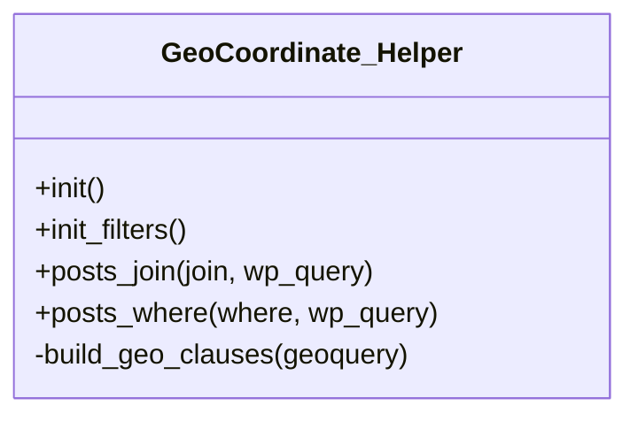

# GeoCoordinate_Helper

Class TainacanFilterType

***

* Full name: `\GeoCoordinate_Helper`

## Class Diagram



## Constants

| Constant     | Visibility | Type | Value        |
|--------------|------------|------|--------------|
| `META_ALIAS` | public     |      | 'mtgeoquery' |

## Methods

### init

```php
public init(): mixed
```

***

### init_filters

```php
public init_filters(): mixed
```

***

### posts_join

```php
public posts_join(mixed $join, mixed $wp_query): mixed
```

**Parameters:**

| Parameter   | Type      | Description |
|-------------|-----------|-------------|
| `$join`     | **mixed** |             |
| `$wp_query` | **mixed** |             |

***

### posts_where

```php
public posts_where(mixed $where, mixed $wp_query): mixed
```

**Parameters:**

| Parameter   | Type      | Description |
|-------------|-----------|-------------|
| `$where`    | **mixed** |             |
| `$wp_query` | **mixed** |             |

***

### build_geo_clauses

Builds one prepared WHERE fragment per valid `geoquery` entry.

```php
private build_geo_clauses(mixed $geoquery): string[]
```

Entries with missing keys or non-numeric coordinates are skipped.

**Parameters:**

| Parameter   | Type      | Description                                                                                          |
|-------------|-----------|------------------------------------------------------------------------------------------------------|
| `$geoquery` | **mixed** | Raw `geoquery` argument: array of ['compare' => 'DISTANCE'\|'CONTAINS', 'key' => metadatum ID, ...]. |

**Return Value:**

Prepared SQL fragments; empty when nothing valid was given.

***

## Inherited methods

### get_instance

```php
public static get_instance(): mixed
```

* This method is **static**.
***

### __construct

```php
private __construct(): mixed
```

***
