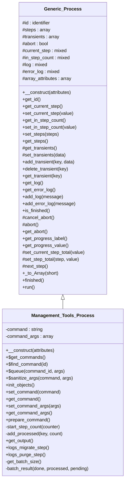

# Management_Tools_Process

Background process that runs management commands (e.g. the legacy logs migration).

The command to run and its args are given as process attributes. The first step
validates the command and its args; the following steps are the ones declared in
the command definition (see get_commands()), each one being a method of this class
that delegates the work to a helper, one batch per iteration.

Usage:

    $bg = Management_Tools_Process::queue( 'logs_migration', [ 'batch_size' => 100, 'purge' => true ] );

To add a new command: add its definition to get_commands() and implement its step methods.

***

* Full name: `\Tainacan\GenericProcess\Management_Tools_Process`
* Parent class: [`\Tainacan\GenericProcess\Generic_Process`](./Generic_Process)

## Class Diagram



## Constants

| Constant | Visibility | Type | Value              |
|----------|------------|------|--------------------|
| `SLUG`   | public     |      | 'management_tools' |

## Properties

### command

Id of the command to run (a key of get_commands()).

```php
private string|null $command
```

***

### command_args

Args given to the command, sanitized according to its params.

```php
private array $command_args
```

***

## Methods

### __construct

```php
public __construct(mixed $attributes = array()): mixed
```

**Parameters:**

| Parameter     | Type      | Description |
|---------------|-----------|-------------|
| `$attributes` | **mixed** |             |

***

### get_commands

Available commands, keyed by id. Each definition has:
- name        (string)
- description (string)
- params      (array) Each entry: name, type (number\|boolean\|text), label, description,
                      default, required, min, max (for numbers) and destructive (bool).

```php
public static get_commands(): array
```

- steps       (array) Each entry: name, progress_label, callback (method of this class)
and, optionally, 'if' => param name: the step only runs when that
param is truthy.

* This method is **static**.
***

### find_command

```php
public static find_command(string $id): array|null
```

* This method is **static**.
**Parameters:**

| Parameter | Type       | Description |
|-----------|------------|-------------|
| `$id`     | **string** |             |

**Return Value:**

The command definition.

***

### queue

Validates the command and its args, and adds a new Management Tools process to the queue.

```php
public static queue(string $command_id, array $args = []): \Tainacan\Background_Generic_Process|\WP_Error
```

* This method is **static**.
**Parameters:**

| Parameter     | Type       | Description                                                   |
|---------------|------------|---------------------------------------------------------------|
| `$command_id` | **string** |                                                               |
| `$args`       | **array**  | Raw args; they are sanitized according to the command params. |

**Return Value:**

The queued background process.

***

### sanitize_args

Validates and sanitizes the args according to the command params.

```php
public static sanitize_args(array $command, array $args): array|\WP_Error
```

Params not declared are discarded.

* This method is **static**.
**Parameters:**

| Parameter  | Type      | Description             |
|------------|-----------|-------------------------|
| `$command` | **array** | The command definition. |
| `$args`    | **array** | Raw args.               |

***

### init_objects

Builds the steps: the "prepare" step followed by the command steps enabled by the args.

```php
public init_objects(): mixed
```

Called on every iteration, since steps are not serialized between requests.

***

### set_command

```php
public set_command(mixed $command): mixed
```

**Parameters:**

| Parameter  | Type      | Description |
|------------|-----------|-------------|
| `$command` | **mixed** |             |

***

### get_command

```php
public get_command(): mixed
```

***

### set_command_args

```php
public set_command_args(mixed $args): mixed
```

**Parameters:**

| Parameter | Type      | Description |
|-----------|-----------|-------------|
| `$args`   | **mixed** |             |

***

### get_command_args

```php
public get_command_args(): mixed
```

***

### prepare_command

Step 1: validates the command and its args.

```php
public prepare_command(): false
```

**Return Value:**

Always moves on to the next step (or aborts).

***

### start_step_count

Stores the total of records of the current step on its first execution,
so the progress bar keeps a fixed reference while records are processed.

```php
private start_step_count(callable $counter): mixed
```

**Parameters:**

| Parameter  | Type         | Description                              |
|------------|--------------|------------------------------------------|
| `$counter` | **callable** | Returns the total of records to process. |

***

### add_processed

Accumulates the number of records processed by a step, used in the final output.

```php
private add_processed(string $key, int $count): int
```

**Parameters:**

| Parameter | Type       | Description |
|-----------|------------|-------------|
| `$key`    | **string** |             |
| `$count`  | **int**    |             |

**Return Value:**

The accumulated count of the current step.

***

### get_output

Message stored as the background process output when it finishes.

```php
public get_output(): string
```

Required by Background_Generic_Process::task().

***

### logs_migrate_step

Migrates one batch of legacy logs.

```php
public logs_migrate_step(): int|false
```

***

### logs_purge_step

Deletes one batch of already migrated legacy logs.

```php
public logs_purge_step(): int|false
```

***

### get_batch_size

```php
private get_batch_size(): int
```

**Return Value:**

The 'batch_size' arg, or 500 when not given.

***

### batch_result

Return value of a batch step, following the Generic_Process convention.

```php
private batch_result(int $done, int $processed, int $pending): int|false
```

Stops (aborting) when a batch makes no progress, to avoid an infinite loop.

**Parameters:**

| Parameter    | Type    | Description                                          |
|--------------|---------|------------------------------------------------------|
| `$done`      | **int** | Accumulated number of processed records in the step. |
| `$processed` | **int** | Number of records processed in this batch.           |
| `$pending`   | **int** | Number of records still pending.                     |

***

## Inherited methods

### __construct

```php
public __construct(mixed $attributes = array()): mixed
```

**Parameters:**

| Parameter     | Type      | Description |
|---------------|-----------|-------------|
| `$attributes` | **mixed** |             |

***

### get_id

```php
public get_id(): string
```

**Return Value:**

the process unique id

***

### get_current_step

```php
public get_current_step(): mixed
```

***

### set_current_step

```php
public set_current_step(mixed $value): mixed
```

**Parameters:**

| Parameter | Type      | Description |
|-----------|-----------|-------------|
| `$value`  | **mixed** |             |

***

### get_in_step_count

```php
public get_in_step_count(): mixed
```

***

### set_in_step_count

```php
public set_in_step_count(mixed $value): mixed
```

**Parameters:**

| Parameter | Type      | Description |
|-----------|-----------|-------------|
| `$value`  | **mixed** |             |

***

### set_steps

```php
public set_steps(mixed $steps): mixed
```

**Parameters:**

| Parameter | Type      | Description |
|-----------|-----------|-------------|
| `$steps`  | **mixed** |             |

***

### get_steps

```php
public get_steps(): mixed
```

***

### get_transients

```php
protected get_transients(): mixed
```

***

### set_transients

```php
protected set_transients(array $data): mixed
```

**Parameters:**

| Parameter | Type      | Description |
|-----------|-----------|-------------|
| `$data`   | **array** |             |

***

### add_transient

```php
public add_transient(mixed $key, mixed $data): mixed
```

**Parameters:**

| Parameter | Type      | Description |
|-----------|-----------|-------------|
| `$key`    | **mixed** |             |
| `$data`   | **mixed** |             |

***

### delete_transient

```php
public delete_transient(mixed $key): mixed
```

**Parameters:**

| Parameter | Type      | Description |
|-----------|-----------|-------------|
| `$key`    | **mixed** |             |

***

### get_transient

```php
public get_transient(mixed $key): mixed
```

**Parameters:**

| Parameter | Type      | Description |
|-----------|-----------|-------------|
| `$key`    | **mixed** |             |

***

### get_log

```php
public get_log(): mixed
```

***

### get_error_log

```php
public get_error_log(): mixed
```

***

### add_log

```php
public add_log(mixed $message): mixed
```

**Parameters:**

| Parameter  | Type      | Description |
|------------|-----------|-------------|
| `$message` | **mixed** |             |

***

### add_error_log

```php
public add_error_log(mixed $message): mixed
```

**Parameters:**

| Parameter  | Type      | Description |
|------------|-----------|-------------|
| `$message` | **mixed** |             |

***

### is_finished

```php
public is_finished(): mixed
```

***

### cancel_abort

Cancel Scheduled abortion at the end of run()

```php
protected cancel_abort(): void
```

***

### abort

Schedule importer abortion at the end of run()

```php
protected abort(): void
```

***

### get_abort

Return whether importer should abort execution or not

```php
public get_abort(): bool
```

***

### get_progress_label

Gets the current label to be displayed below the progress bar to give
feedback to the user.

```php
public get_progress_label(): string
```

It automatically gets the attribute progress_label from the current step running.

***

### get_progress_value

Gets the current value to build the progress bar and give feedback to the user
on the background process that is running the process.

```php
public get_progress_value(): mixed
```

It does so by comparing the "size" attribute with the $in_step_count class attribute
where size indicates the total size of iterations the step will take and $this->in_step_count
is the current iteration.


The value must be from 0 to 100

If a negative value is passed, it is assumed that the progress is unknown

***

### set_current_step_total

Sets the total attribute for the current step

```php
protected set_current_step_total(mixed $value): mixed
```

The "total" attribute of a step indicates the number of iterations this step will take to complete.

The iteration is counted using $this->in_step_count attribute, and comparing the two values gives us
the current progress of the process.

**Parameters:**

| Parameter | Type      | Description |
|-----------|-----------|-------------|
| `$value`  | **mixed** |             |

***

### set_step_total

Sets the total attribute for a given step

```php
protected set_step_total(mixed $step, mixed $value): mixed
```

The "total" attribute of a step indicates the number of iterations this step will take to complete.

The iteration is counted using $this->in_step_count attribute, and comparing the two values gives us
the current progress of the process.

**Parameters:**

| Parameter | Type      | Description |
|-----------|-----------|-------------|
| `$step`   | **mixed** |             |
| `$value`  | **mixed** |             |

***

### next_step

```php
protected next_step(): mixed
```

***

### _to_Array

```php
public _to_Array(mixed $short = false): mixed
```

**Parameters:**

| Parameter | Type      | Description |
|-----------|-----------|-------------|
| `$short`  | **mixed** |             |

***

### finished

```php
public finished(): mixed
```

***

### run

runs one iteration

```php
public run(): mixed
```

***
