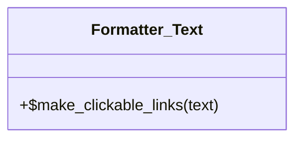

# Formatter_Text

Class for formatter texts

***

* Full name: `\Tainacan\Traits\Formatter_Text`

## Class Diagram



## Methods

### make_clickable_links

```php
public static make_clickable_links(mixed $text): string
```

* This method is **static**.
**Parameters:**

| Parameter | Type      | Description |
|-----------|-----------|-------------|
| `$text`   | **mixed** |             |

**Return Value:**

Texts with url's and emails transformed in html tag <a>. It uses WordPress function make_clickable() to do this.

***
